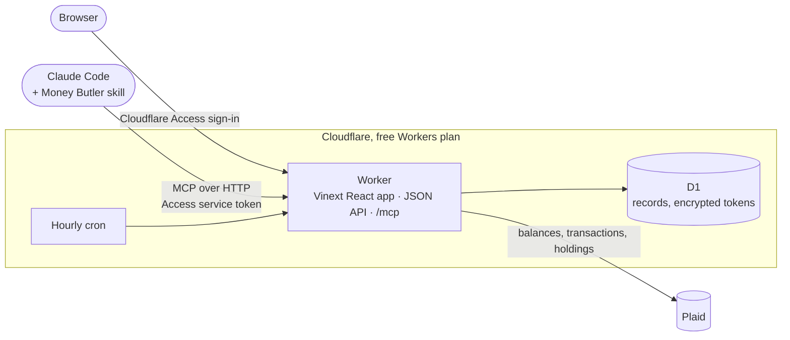

# Ben's Money

[](https://github.com/benburw3ll/bens-money-showcase/actions/workflows/test.yml)

**One private place for accounts, investments, and the path to paying off a home, with Claude as the money butler.**

Ben's Money is a personal finance dashboard I run on my own Cloudflare account. This public repository is a showcase. It holds selected calculation code, tests, and the Claude integration that reviews my finances on request.

> **Every number, name, and institution in this repository is invented.** The examples use a made-up household and never touched the live database, a bank, or a real account.

## What it does

- **One picture of everything.** Bank, brokerage, retirement, and HSA balances, plus mortgage principal paid, combine into a *personal total* with a dated history. That total is a progress measure, not net worth, and the app says so.
- **Mortgage planning.** Amortization runs in integer cents. Try an extra monthly payment and the app shows the new payoff date and interest saved before you commit to anything.
- **Investments without double counting.** Holdings explain what's inside an account. They are never added to its balance a second time.
- **Claude as the Money Butler.** Claude Code connects to the app over MCP, syncs, reads the full history, and writes a ranked, evidence-based review. [More below](#claude-as-the-money-butler).

## A closer look

### Mortgage planning

The current balance, home equity, payoff date, and where each year's payments go are all on one screen. For this invented $214,000 loan at 5.75%, an extra $200 a month moves payoff from October 2043 to December 2040 and saves about $22,587 in interest. It is a preview only and never schedules a payment.

### Investments

Brokerage, retirement, and HSA accounts sit together with the holdings inside them. Positions explain a balance and are never added on top of it.

## How it's built



- **Owner-only by construction.** Cloudflare Access guards the whole hostname, and the Worker verifies the Access JWT itself. It admits exactly two identities: the owner's email in a browser, and one service token for Claude. Every query is scoped to the owner, and writes require a same-origin request.
- **Built to fit the free plan.** Workers Free allows about 10 ms of CPU per request. Instead of one big nightly sync, an hourly cron does one small, resumable step. [`lib/sync-policy.ts`](lib/sync-policy.ts) and [`lib/sync-pagination.ts`](lib/sync-pagination.ts) show how.
- **Money is integers.** Every amount is stored and calculated in cents, and dates are plain `YYYY-MM-DD` strings.

## Claude as the Money Butler

Claude Code connects to the app's owner-only MCP endpoint and runs a skill called **Money Butler**. It syncs every connection, reads every page of saved history, and checks dates and coverage. Then it writes a ranked review that shows its math and confidence, asks for missing goals instead of guessing, and never moves money.

```text
list_connections → sync_connection → get_data_inventory → get_financial_snapshot
                 → get_financial_records (paged until next_offset is null) → review
```

| File | What it shows |
| --- | --- |
| [`claude/README.md`](claude/README.md) | How Claude authenticates (Cloudflare Access, JWT re-verification, a DPAPI-backed headers helper) and why the server is stateless and read-only. |
| [`claude/money-butler/SKILL.md`](claude/money-butler/SKILL.md) | The skill Claude follows, plus a [data guide](claude/money-butler/references/data-guide.md) for reconciling totals without double counting. |
| [`claude/example-review.md`](claude/example-review.md) | A sample run against a fictional household. |

## Code tour

| File | What it demonstrates |
| --- | --- |
| [`lib/mortgage.ts`](lib/mortgage.ts) | Monthly amortization in integer cents, extra payments, payoff projections, and annual totals. |
| [`lib/personal-progress.ts`](lib/personal-progress.ts) | The personal total: eligible balances plus mortgage principal paid, with a dated history and explicit handling of missing data. |
| [`lib/spending-review.ts`](lib/spending-review.ts) | Where the money keeps going: merchant grouping, recurring-service detection, time windows, and the largest charges. The caller supplies institutions and patterns, so nothing is hardcoded. |
| [`lib/sync-policy.ts`](lib/sync-policy.ts) | Free-plan scheduling: each hourly run resumes an unfinished sync first, otherwise it takes the stalest connection. |
| [`lib/sync-pagination.ts`](lib/sync-pagination.ts) | Resumable paging that saves a checkpoint after every page, so an interrupted sync continues without duplicates. |
| [`tests/`](tests/) | 23 synthetic tests covering payoff math, incomplete records, spending windows, lock expiry, and cursors that stop advancing. |

Run the tests with Node.js 22.13 or newer. There are no dependencies to install:

```sh
npm test
```

## What isn't here

The full app and its records stay private. This repository leaves out authentication code, Plaid token handling, deployment configuration, and anything derived from real data. A separate private snapshot holds the complete source with placeholders in place of deployment values.

Ben's Money is built and maintained with [Claude Code](https://claude.com/claude-code).
