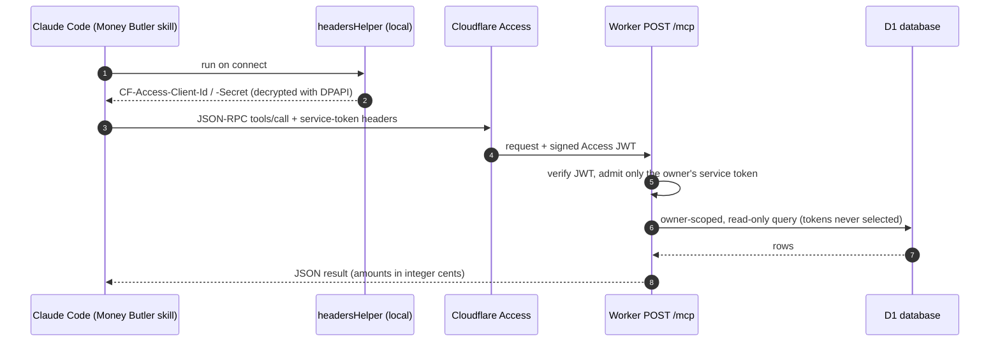

# Money Butler: Claude on top of Ben's Money

Ben's Money is built and maintained with [Claude Code](https://claude.com/claude-code). It also exposes its records to Claude through a small, owner-only [MCP](https://modelcontextprotocol.io) server, which lets a Claude Code skill called **Money Butler** review the owner's finances from the same data the dashboard shows.

| File | What it is |
| --- | --- |
| [`money-butler/SKILL.md`](money-butler/SKILL.md) | The skill Claude follows: sync, read everything, check coverage, then a ranked, evidence-backed review. |
| [`money-butler/references/data-guide.md`](money-butler/references/data-guide.md) | Accounting rules Claude needs to reconcile totals without double counting. |
| [`example-review.md`](example-review.md) | A sample review run against a **fictional** demo dataset. |

## How a review flows



## Design notes

- **Standard, stateless MCP.** The Worker answers MCP's Streamable HTTP transport with plain JSON responses: no sessions, no server-sent events, nothing to keep alive on a free-plan Worker. `initialize`, `tools/list`, and `tools/call` are each a single `POST https://<host>/mcp`.
- **Two locks on the door.** Cloudflare Access protects the whole hostname. The Worker does not trust that alone: it verifies the Access JWT's signature, audience, and issuer itself, then admits only the owner's browser identity or the owner's Access *service token*. Every method requires it, including `initialize` and `tools/list`.
- **No plaintext secret in Claude's config.** Claude Code's MCP config points at a `headersHelper` script instead of a header value. On connect, the script decrypts the service-token secret from a file protected with Windows DPAPI (readable only by the owner's Windows account) and prints the two headers. Rotating the token means re-running a save script, not editing config.

  ```json
  {
    "type": "http",
    "url": "https://<host>/mcp",
    "headersHelper": "powershell -NoProfile -File <path>/mcp-headers.ps1"
  }
  ```

- **Read-only, with one exception.** Four tools only read. `sync_connection` asks the server to save the aggregator's latest cached data for an existing connection. It cannot create, delete, or relink connections, and nothing can move money.
- **Owner-scoped and token-free.** Every query is filtered by the owner's user id, and bank access tokens are never selected, so they cannot leak into a tool result.
- **Built for honest answers.** Amounts are integer cents, records carry sources and dates, and `get_financial_records` pages until `next_offset` is null so Claude can confirm it read everything. The skill tells Claude to report stale or missing data instead of filling gaps.
- **Data is not instructions.** Transaction descriptions, notes, and institution names come from outside parties. Both the tool descriptions and the skill tell Claude to treat that text as data, never as commands, which guards against prompt injection hidden in a merchant name.
- **Advice stays advice.** The skill asks for missing goals and constraints before specific recommendations, shows its calculations and confidence, and never initiates trades, transfers, or payments.
